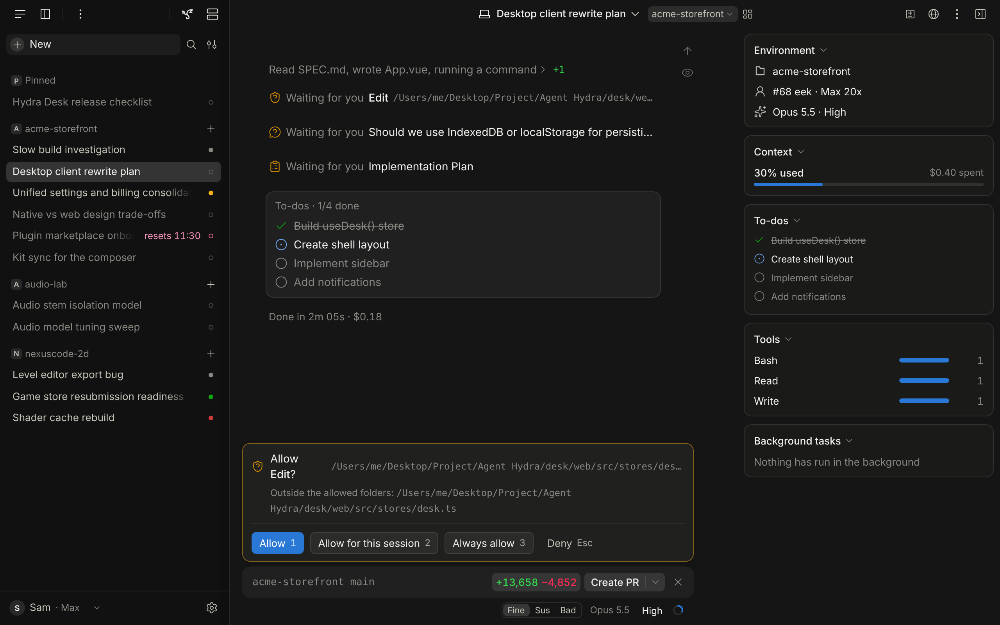
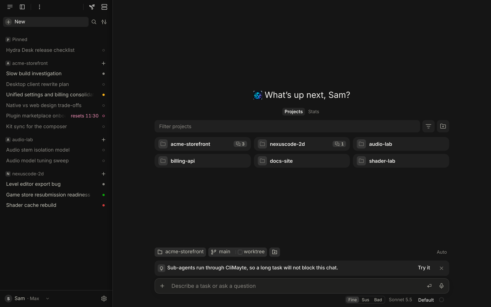
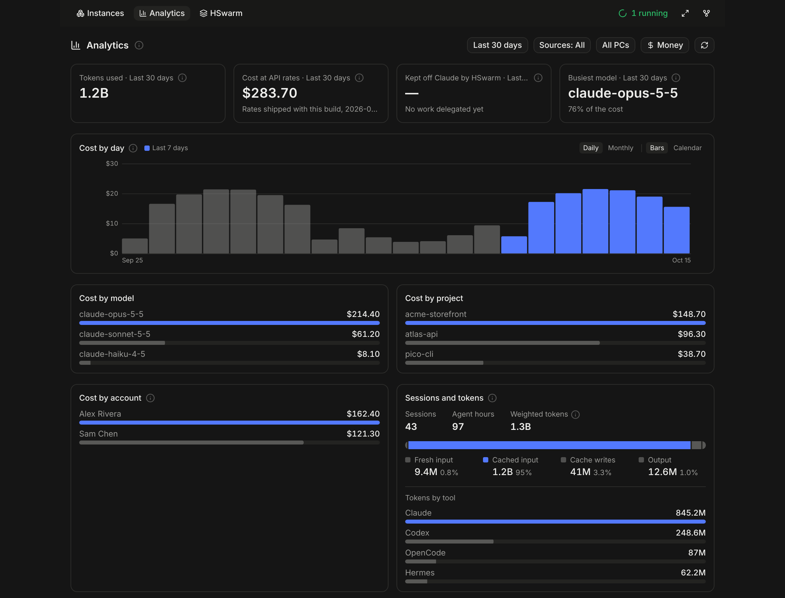
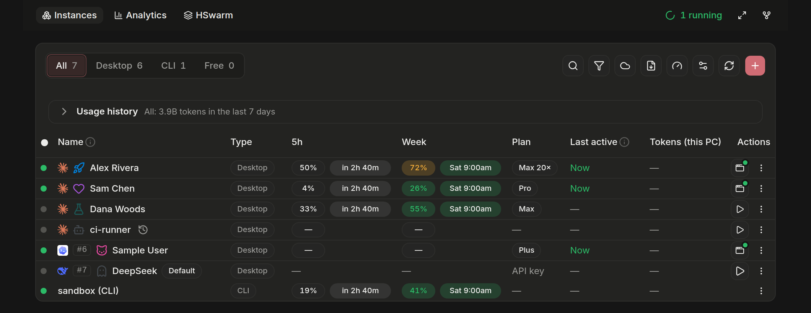

<div align="center">

# AgentHydra Community

### One dashboard. Multiple PCs. Your own server.

[Download](https://github.com/Jhacarreiro/AgentHydra-Community/releases) &nbsp;·&nbsp; [Reference](docs/REFERENCE.md) &nbsp;·&nbsp; [Changelog](CHANGELOG.md) &nbsp;·&nbsp; [Contributing](CONTRIBUTING.md)

[](https://github.com/Jhacarreiro/AgentHydra-Community/actions/workflows/ci.yml)
[](https://github.com/Jhacarreiro/AgentHydra-Community/actions/workflows/audit-public.yml)
[](https://github.com/Jhacarreiro/AgentHydra-Community/releases)
[](LICENSE)

</div>

---

**AgentHydra Community** brings AI coding sessions, accounts and projects into one dashboard. Run it locally or use a self-hosted hub to work across multiple PCs, with individual device authentication and control over your infrastructure. No hosted account required.

**Available now:** support for Claude Code, Codex and OpenCode, plus a self-hosted multi-PC hub. **In development:** ChatGPT access in the same interface (not yet included in a release).

[Get started](docs/GETTING-STARTED.md) · [Latest release](https://github.com/Jhacarreiro/AgentHydra-Community/releases/latest) · [Contribute](CONTRIBUTING.md)

**One home server for several PCs.** Run AgentHydra on a home server, or any PC that
stays on, and let your other PCs report to it:

- **Codex hub:** each PC pushes its Codex chats to that one AgentHydra, which lists, searches and opens them beside
  its own, each marked with the PC it came from. While a PC is on, you can continue one of its chats from the hub:
  the turn runs on that PC, with its files and its Codex sign-in, and asks you for approvals as usual.
- **A tray app on each PC** (Windows, macOS or Linux; you build it with your hub's addresses): it pairs the PC
  through a page behind your own sign-in, starts at login, keeps the PC sending, and updates itself and the pusher
  from the hub, taking only builds signed with your key (or, built without a key, only over https).
- **Claude Code cloud sessions beside local ones:** cloud and Remote Control sessions appear in the same list as the
  chats on your disk, read-only, with which ones are working or waiting on you.
- **The inbox from a phone:** the window can sit behind a reverse proxy that signs you in first, so the same list
  opens on your phone.

All of this is off until you set it up, and it is new: 2026.10.0 is the first release that has it. This
repository's tests run the hub and the tray on Linux, including two PCs that pair, push and relay through the real
daemon. The hub and tray were also tested in a self-hosted setup before the first release. See [One server, several PCs](#one-server-several-pcs).

Maintained independently by [@Jhacarreiro](https://github.com/Jhacarreiro) and contributors. The codebase originates from a previously MIT-licensed AgentHydra revision; original copyright notices are preserved in [LICENSE](LICENSE) and [NOTICE](NOTICE). [Provenance details](docs/FORK.md) are available for those who need them.



<sub>Screenshots use demo data and predate the fork: the analytics and instances shots still show a Discord button
where the repository link now is, and the window shots name a demo project "connections".</sub>

## TL;DR

- **One server, several PCs:** your PCs' Codex chats in one inbox, continued on the PC they belong to, with a tray
  app that pairs each PC (opt-in)
- **Claude Code cloud sessions beside local ones:** which are working or waiting on you, in the same list (opt-in)
- **Every chat in one sidebar:** AgentHydra's own Claude Code chats, Claude Desktop's and the CLI's, Codex and
  OpenCode, grouped by project, live while they run
- **New starts from your projects:** a grid with each one's git state and open chats, the busiest first
- **Dev servers built in:** start, stop and watch your projects' local servers, and open them beside the chat
- **CliMayte:** hand a task's pieces to your other Claude CLI accounts, and a worker moves on when one runs out
- **Where the time and money went:** cost by day, model, project and account, and what is wasting it
- **Every Claude and Codex account in one table:** plan, 5-hour and weekly quota, open, quit, create
- **For agents too:** the whole thing over MCP, including "which account am I, and how much is left"
- **No vendor-hosted backend required:** no install id except to a hub you operate; the network accesses are documented under [Install](#install)
- **A public audit** checks every file, and every commit after the import, for secrets and personal data, and
  refuses any commit built on upstream's own history or on its relicensing commit

<details>
<summary><b>Read more: what each part does</b></summary>

### Every chat, in one window

- The sidebar holds AgentHydra's own Claude Code chats (composer, permission prompts, to-dos, diffs,
  Create PR) beside your Claude Desktop chats and CLI sessions, grouped by project. Filter by app, or
  keep only what is running or waiting on you. With Login sync, your other PC's chats are there too.
- Codex chats are listed and can be continued in the window, on the Codex account that holds them. OpenCode,
  Hermes and DeepSeek Harness conversations are listed and readable.
- **New** opens a grid of your projects, from the folders you add, wherever your chats ran and Project Hydra
  if you use it, each with its git state and how many chats are open in it. A chat started in a parent
  folder counts for the project it actually worked in, and is filed into that project's group.



### Dev servers, built in

- The Dev servers page lists your projects' local servers: start, stop, restart, logs, errors, CPU
  and memory, alerts. A browser pane beside the chat opens any of them.
- A folder needs no setup: it reads Claude Code's `.claude/launch.json`, or `package.json`'s dev
  scripts. (This was DevWebUI; it is part of AgentHydra now.)
- **ChatGPT handoff** packs the task and repository into a Markdown file (common secret files left
  out), copies a prompt and opens ChatGPT. You review and send it yourself.
- Open a raw Claude or Codex `.jsonl` in your editor, download it under its title, or copy it.

### Reply, fan out, or move a session, never headless

AgentHydra never runs a chat you cannot see: every run is in a real app window.

- **Reply** into a session's own desktop chat; it checks the message landed. A busy chat says so.
- **Fan out** a task list across your other signed-in accounts (MCP `fan_out`), one visible chat
  each, and steer them with `fan_out_send`.
- **Import** a session into a desktop app to continue it by hand.
- **Move** a chat to another account with `move_chat`, or several with `move_chats`. It keeps its
  history ([Moving chats between accounts](docs/MOVING-CHATS-BETWEEN-ACCOUNTS.md)).

The old run queue stays as a read-only record. Starting a new headless run is refused on purpose.

### CliMayte: hand a task's pieces to your CLI accounts

- A chat keeps the plan and hands each piece to a Claude Code CLI session on one of your accounts.
  When an account nears its limit, the worker moves to another and carries on.
- No console windows, but nothing hidden: every worker is readable and steerable in the CliMayte
  view, and its transcript is a normal session.
- **Quick add:** type an email, sign in in the window it opens, and the account is ready.
- **Two PCs:** with Login sync, each PC sees the other's CliMayte tasks and never crowds the same
  account. Desktop and AgentHydra chats can be shared too, view only.
- Over MCP: `climayte_run`, `climayte_status`, `climayte_send`, `climayte_cancel`, `cli_limit_reset`.
  Details: [docs/CLIMAYTE.md](docs/CLIMAYTE.md).

### Where the time and the money went



- Cost by day, model, project and account (at list prices: what the same work would cost on the
  API). When in the week you work, how many sessions ran at once, which tools were used.
- Why it cost that much: skills and MCP servers loaded and never used, calls past 150k tokens of
  context, what subagents spent, cache use per account, each with a one-line fix.
- Sessions worth a second look: a tool that kept failing, a compacted context, code that was gone
  from its files two hours later.
- **Recurring mistakes** pairs each failed shell command with the one that fixed it, and **Copy as
  rules** turns them into a rules file for your agents.
- `AgentHydra.exe --spend --json` prints the same numbers.

### Every account, in one table



- Each Claude Desktop instance with its account, plan, quota and process. Open, focus, quit,
  create and delete them, and give each a name, icon and colour.
- Codex Desktop and CLI the same way, each with its own login.
- **Claude native control:** turn on **Start debugger automatically** for an account
  (**Settings → Instances → Desktop**) and archiving and migration use Claude's own session
  manager ([guide](docs/CLAUDE-DESKTOP-NATIVE-CONTROL.md)).
- **Quick instance mode** (`AgentHydra.exe --instances`, or `bun run instances` from source) opens a
  small window that only starts and stops instances.

### For agents

- Everything is on MCP ([docs/REFERENCE.md](docs/REFERENCE.md)).
- `whoami` and the usage tools tell an agent which account it runs on and what is left, before it
  fans out ([docs/AI_USAGE_SELFCHECK.md](docs/AI_USAGE_SELFCHECK.md)).
- The **orchestrator** ([`orchestrator/`](orchestrator/README.md)) decides what should happen to a
  chat (sweeps, moves, archiving, naming), through the same MCP server and only while the tray icon
  is up. `orch.py policy` holds its switches.

### How it compares

Claude Squad and Conductor start new sessions in fresh git worktrees. AgentHydra starts nothing on its
own: it reads the history and account state your tools already write, and adds analytics and account
management on top. Cursor and Windsurf are editors; AgentHydra is a dashboard over the CLIs and apps
you already have.

</details>

## One server, several PCs

Pick one AgentHydra as the hub, usually on a home server that stays on, and point each PC at it. Nothing below
runs until you set its variables. [docs/CODEX-HUB.md](docs/CODEX-HUB.md) walks through running a hub of your own: the
server, your proxy and sign-in, building and installing the tray, listing and revoking PCs, and changing the key.

<details>
<summary><b>Read more: the hub, each PC, the tray app, cloud sessions and the phone</b></summary>

- **The hub:** set `AGENTHYDRA_CODEX_HUB_TOKEN` to a long random token, your own admin token, which no PC is
  given. Like the rest of AgentHydra's API, the hub answers loopback only, so other PCs reach it through a reverse
  proxy you run: `/api/codex-hub/`, where each PC's own token is the authentication, and the pairing page
  `/codex-hub/pair`, which hands out one-time pairing codes and so is served only behind your own sign-in. On a
  machine with no screen, `AGENTHYDRA_DESK_AT_BOOT=1` starts the window's server with the daemon, so the proxy has
  something to reach after a restart.
- **Each PC has a token of its own:** it pushes and relays as that PC alone, and only from the install it was
  first used with. `scripts/codex-hub-pcs.ts` on the hub lists the PCs and revokes one at once without touching
  the others, and a chat in Desk whose PC you revoked says so. A hub set up before this moves its PCs off the one
  token they shared, by themselves, while a migration window you open lasts.
- **Each PC:** the tray app below sets it up. Without the tray, set `AGENTHYDRA_CODEX_HUB_URL` and, in
  `AGENTHYDRA_CODEX_HUB_TOKEN`, a token for that PC from `scripts/codex-hub-pcs.ts add`. Its AgentHydra pushes its
  Codex chat list and the chats that changed every two minutes; a PC that does not run AgentHydra can run the
  standalone pusher. A chat archived or deleted on the PC leaves the hub at its next push. The hub's usage
  analytics leave these chats out, since they are the other PC's usage.
- **Continuing a chat from the hub:** the PC keeps a connection open to the hub, and when you continue one of its
  chats, its own Codex runs the turn. The PC lets the hub only read, resume, start and stop turns in chats it
  already has (never start a chat, change its configuration or sign in), and by default it refuses a turn without
  approvals or outside the sandbox. Close the chat in the Codex app on that PC first.
- **The tray app** (`codex-hub-tray/`, Go) is built by whoever runs the hub, with `codex-hub-tray/build.sh`, the
  hub's addresses and your own signing key's public half; the script stops without a key unless you set
  `ALLOW_NO_KEY=1`. No release includes it. Each build comes with AgentHydra's `LICENSE`, its `NOTICE` and a
  `THIRD-PARTY-LICENSES` file for its system (inside the macOS app), to hand out with it. Two builds of one commit
  with the same addresses and key are the same bytes, so you can check what a PC runs (a Mac's zip has a checksum
  file of its own instead). Opened once, it installs itself for the user, starts at login, opens the pairing page
  to get a token of its own, runs the pusher, shows in its icon whether the PC is sending, and takes new pusher and
  tray builds from the hub, only ones your key signed.
  A build can trust two keys, so the PCs move to a new key without being set up again.
  `bun scripts/codex-hub-sign.ts` makes the key and signs builds. On a Mac, `build.sh` also builds the macOS app
  (through `build-macos.sh`), and `test-macos.sh` smoke-tests it there.
- **How far the hub is tested:** this repository's tests run on Linux. They start the real daemon as a hub with two
  PCs that pair, push and relay with tokens of their own, act only as their own PC whatever name they send, are
  refused with a wrong token, are revoked one at a time, and move off the shared token of before; and they run the
  tray end to end against a stand-in hub and against the real one. In this repository the Windows tray has had
  only `go vet` and a build, the macOS one has not run, and no real proxy or sign-in is under test. Before the
  fork, the hub and tray, then on one shared token, ran in the maintainer's own setup with Windows PCs and were
  tried on a Mac.
- **Claude Code cloud sessions:** set `AGENTHYDRA_CLOUD_SESSIONS=1`. AgentHydra then asks Anthropic's API, with
  each Claude Code CLI login it finds (or a `claude setup-token` token in `CLAUDE_CODE_OAUTH_TOKEN`), for that
  account's cloud and Remote Control sessions, and lists them with your local chats. The token needs the
  `user:sessions:claude_code` scope; it is never stored, logged or refreshed by AgentHydra.
- **From a phone:** put a reverse proxy that signs you in first (Cloudflare Access, oauth2-proxy, or a name only
  your VPN resolves) in front of the window, and list its address in `HYDRA_DESK_PUBLIC_ORIGINS`
  (for example `https://desk.example.com`). That name is then trusted like the machine itself, so never list one
  anyone can reach without the sign-in.

Details: [the multi-PC getting-started steps](docs/GETTING-STARTED.md#b-see-codex-chats-from-several-pcs-in-one-place) for the recommended setup order, and [docs/CODEX-HUB.md](docs/CODEX-HUB.md) for running a hub,
[Codex chats from other PCs](docs/REFERENCE.md#codex-chats-from-other-pcs-codex-hub) for its routes and variables, and
the window's [ports and remote access](desk2/README.md#ports).

</details>

## Install

**New here?** Start with the [step-by-step installation guide](docs/GETTING-STARTED.md): one PC first, or a separate setup for a self-hosted multi-PC Codex hub. The normal app installer does not configure a hub or build a tray for your server.

**Windows, one line** (no Administrator; the download's SHA-256 is checked before anything unpacks):

```powershell
irm https://raw.githubusercontent.com/Jhacarreiro/AgentHydra-Community/main/install.ps1 | iex
```

Or take a download from the [releases page](https://github.com/Jhacarreiro/AgentHydra-Community/releases): the
Windows `.zip` (unpack it and run `AgentHydra.exe` in its folder), or the `.tar.gz` for Linux or macOS. An installed
copy updates itself from this repository's releases once you turn auto-update on in Settings, and
`install.ps1 -FromZip <zip>` installs a zip you downloaded or built yourself ([docs/RELEASING.md](docs/RELEASING.md)).

**From source** (Windows, macOS or Linux), with [Bun](https://bun.sh) 1.4.3:

```sh
git clone https://github.com/Jhacarreiro/AgentHydra-Community.git
cd AgentHydra-Community && bun install && bun install --cwd desk2
bun run build && bun run start
```

On Windows, `bun scripts/build-natives.ts` also builds the tray icon, the window and CliMayte's worker runner from
their Rust source (it needs Rust and Visual Studio's C++ build tools). Without them AgentHydra still runs: the tray
is the PowerShell one, and AgentHydra opens in your browser.

<details>
<summary><b>Read more: downloads, Windows programs, licences, versions, updates, requirements, network</b></summary>

- **Downloads:** the Windows `.zip` holds the whole app: the window, the tray icon and the orchestrator tools. A
  release also has a single `.exe`, a small launcher that fetches the rest of the app from the same release the
  first time you run it; a release built while updates were off has the zip only, since a build with updates off
  downloads no part of AgentHydra. Linux and macOS get a `.tar.gz`. No download
  packs Bun, Claude Code or the Claude Agent SDK: the launcher fetches the Bun the release was built with on first
  run, and again after an update that changes that version (checked against Bun's published checksums), and the
  window fetches Claude Code, and the Agent SDK the release pins, when a chat first needs them.
- **Windows programs:** the tray icon (`misc\AgentHydra-Tray.exe`), the window (`desk2\launcher\HydraDesk2.exe`) and
  CliMayte's worker runner (`misc\climayte-runner.exe`) are built from the Rust source in this repository and are
  never committed. Every Windows release builds its own copies and publishes their checksums beside the download
  (`AgentHydra-<version>-windows-x64-natives.sha256`). In a source checkout, build them with
  `bun scripts/build-natives.ts`, which needs Rust ([rustup.rs](https://rustup.rs)) and Visual Studio's C++ build
  tools. Until you do, AgentHydra still runs, with less:
  - the shortcut that `misc\Create-Shortcut.ps1` makes runs the PowerShell tray;
  - the shortcut from `desk2\launcher\install-shortcuts.ps1` starts that tray and opens AgentHydra in your default
    browser instead of its own window;
  - CliMayte workers run without the native runner's process limit.

  A checkout from before these programs left the tree loses its copies when it updates. Build them, or run
  `misc\Create-Shortcut.ps1` again, so the AgentHydra shortcut opens again.
- **Licences in a release:** every bundle carries `LICENSE` (MIT), `NOTICE` (where this project comes from),
  `THIRD-PARTY-NOTICES.md` for the code AgentHydra adapts from other projects, `LICENSES/`, and
  `THIRD-PARTY-LICENSES`. That last file gives the name, version, licence and licence text of every third-party
  package whose code is in the bundle: its npm packages and, in the Windows bundle, the Rust crates of its programs
  and Rust's own licences. A release is not built if any of them has no licence, no licence text, or a licence
  outside a permissive allowlist (MIT, MIT-0, ISC, BSD, Apache-2.0, 0BSD, BlueOak, CC0, OFL, Unlicense, Zlib,
  Unicode, BSL-1.0 and MPL-2.0). The Windows installer puts them beside `AgentHydra.exe`, and an in-app update
  brings the new release's copies.
- **The Claude Agent SDK** is not in any bundle: its licence reserves all rights. The first time a chat needs it,
  AgentHydra downloads the exact version the release pins, checks its sha512 against the pin, and unpacks it into
  `desk2/node_modules`, where it stays across in-app updates. Meanwhile the chat shows "Getting the Claude Agent SDK"
  and the version; if the download fails, it says why (offline, not the pinned package, or a folder it cannot write)
  and offers a Retry. A source checkout uses what `bun install` put in `node_modules` and never downloads it.
- **Versions** are numbered by date, `YYYY.M.PATCH`, starting at `2026.10.0`, so they never collide with the
  `0.x`, `1.x` and `2.0.x` releases of the project this one was forked from.
- **Updates** come only from this repository, the one named in `release-channel.json`, and auto-update is off
  until you turn it on in Settings. A release build does only what its channel allows: `off` checks nothing and
  downloads nothing (the setting before the first release), `notify` tells you about a newer release, and `auto`
  installs it, taking only files from this repository's release downloads, checked against that release's
  `SHA256SUMS.txt`. A source checkout updates with `git pull --ff-only` of the branch it tracks, and only when that
  remote is this repository on GitHub; any other remote is reported in Settings and never contacted. It checks
  that remote whether auto-update is on or off: turning it on only lets the update apply.
- **Requirements:** Bun only for a source checkout (and on Windows, Rust and Visual Studio's C++ build tools if you
  build the programs above). The `claude` CLI and/or Claude Desktop for the
  Claude features. Optional: Codex Desktop/CLI, OpenCode, Hermes Agent, the DeepSeek Harness
  (`~/.dsh`), whose sessions show up when their stores exist. Windows for the tray; macOS and Linux
  builds exist but are not verified yet. Windows instance management needs the classic Squirrel
  installer of Claude Desktop, not the MSIX package (the Instances view links it).
- **Instance actions are real:** open, quit, create and delete act on your real Claude Desktop
  instances; delete asks you to type the name.
- **Network.** AgentHydra reads local files and talks to `localhost`. Nothing goes to a LunarWerx service, and no
  install id or ping goes to any service you did not set up yourself. What does leave the machine on its own:
  - **The update check:** a release build makes one unauthenticated request to `api.github.com` for this
    repository's latest release, only when the release channel allows checking (never while it says `off`). A
    source checkout checks with `git ls-remote` of the branch it tracks, and a `git fetch` of it when it has moved,
    on the update-check timer (every six hours by default) even while auto-update is off, and only when that
    remote is this repository on GitHub.
  - **A launcher repair:** a release launcher that finds part of its install missing downloads its own version's
    archive from this repository's releases, when the channel says `notify` or `auto`. While it says `off`, the
    launcher names the missing parts and downloads nothing, unless `AGENTHYDRA_RELEASE_BASE` names a base.
  - **Bun** from Bun's GitHub releases on a release build's first run, and again after an update that changes the
    Bun version the release pins. **Claude Code**, and in a release the **Claude Agent SDK** at the version the
    release pins, from the npm registry (or the mirror `npm_config_registry` names) when a chat first needs them.
  - **Claude upkeep:** on Windows with Claude Desktop's classic install, about once an hour AgentHydra asks Claude
    Desktop's own update feed at `api.anthropic.com` for its newest build, with the device id, version and OS
    version the app itself sends there. When the install is behind, it runs the install's own updater, which
    downloads the new build from Anthropic, and it updates the npm Claude Code CLI to the Desktop's version while
    nothing runs from it. `AGENTHYDRA_VERSION_AUTOFIX=0` keeps the feed check but turns both updates into a
    notice. On any system, an npm-installed Claude Code CLI that stops starting is repaired at its own version
    from the npm registry.
  - **Model prices:** once a day, LiteLLM's public price list from `raw.githubusercontent.com`, so new models
    are priced; `AGENTHYDRA_PRICES_URL` points it at your own copy. Without it, the bundled table is used.
  - **Your own accounts:** usage and plan lookups for the Claude and Codex accounts you sign in, with their own
    logins, to Anthropic (`api.anthropic.com`, and `platform.claude.com` to renew a closed Desktop profile's
    login) and OpenAI (`chatgpt.com`). When AgentHydra finds a DeepSeek key (in `DEEPSEEK_API_KEYS` or
    `DEEPSEEK_API_KEY`, HSwarm's key file, or the DeepSeek Harness's `~/.dsh/.credentials.yaml`), a usage survey
    also asks `api.deepseek.com` for that account's balance, at most once every five minutes.
  - **HSwarm,** in a source checkout (a release does not include it): AgentHydra starts it unless
    `AGENTHYDRA_HSWARM_ENABLED=0`. It calls the model providers whose keys you add. While its MCP tools are in use
    it also reads Artificial Analysis's public model pages (`artificialanalysis.ai`) at most once a day, to score
    new models, with or without a key, and opening its console fetches the icon of every listed provider whose
    icon it has not fetched yet, from that provider's website.
  - **Only what you turn on:** cloud sessions (Anthropic's API), the Codex hub (your hub, which gets each PC's
    name, taken from its computer name unless you set one, and a random install id), Login sync (the store
    you deploy), usage sync between PCs (a private git repository you name), email alerts (your SMTP server),
    Free instances (claude.ai and chatgpt.com, plus the Python and Node packages they install once), orchestrator
    remote access (your sign-in provider and tunnel), and Desk's RepoYeti and ReDesign connectors, third-party apps
    by LunarWerx, which download that app's release from its GitHub repository when you install one.

</details>

## Optional features, off by default

Some parts reach outside your PC or depend on someone else's terms, so each one waits for you to set it up.

<details>
<summary><b>Read more: remote access, Free instances, Login sync, third-party connectors</b></summary>

- **Orchestrator remote access** (the dashboard from a phone): a fresh clone has no sign-in provider, no relay
  and no tunnel. The gateway serves loopback only and refuses to open a tunnel, and the tray's Remote access
  starts off. To use it, put your own OpenID Connect provider in `orchestrator/state/remote/config.json`:

  ```json
  {
    "oauth": {
      "issuer": "https://accounts.example.com",
      "clientId": "<your client id>",
      "redirectUri": "https://<your relay>/oauth/callback"
    }
  }
  ```

  A named tunnel on your own Cloudflare zone needs `CF_ACCOUNT_ID`, `CF_ZONE_ID`, `CF_ZONE_NAME` and an API token
  in the environment; with one missing it says which and stops. See
  [orchestrator/README.md](orchestrator/README.md), "The remote front-end".
- **Free instances** (Windows only): the window can run work on free claude.ai and ChatGPT web logins. Nothing is
  installed and nothing reaches the network until you add an account under **Instances → Free** and sign in by
  hand in the browser window it opens. The first use needs Python 3.11+, Bun and Node.js, and sets up a Python
  environment under `~/.hydra-desk-2/free/runtime`. Each login is sealed with Windows DPAPI, so sign-in fails on
  Linux and macOS. HSwarm sends nothing to Free accounts until you set `route_via_free = true` in its
  `settings.toml`. These logins go through the providers' own websites: **check that their terms allow this use
  before you turn it on.**
- **Login sync** keeps your CLI and Claude Desktop logins the same on your PCs through a store you deploy yourself
  ([cloud/login-sync-worker](cloud/login-sync-worker/README.md)). There is no built-in store.
- **Desk's RepoYeti and ReDesign connectors** are third-party apps by LunarWerx, not part of this project. Each is
  off until you turn on its **Use it in Desk** switch in Settings → Connectors, or press Install or Start on its
  row. Until then Desk only checks whether a copy already answers on this PC: it downloads and starts nothing and
  gives chats none of its tools. Installing one downloads that app's release from its own GitHub repository.
- **Orchestrator jobs** use only folders you name: the to-do sweep is registered when `PROJECTHYDRA_HOME` points
  at your Project Hydra clone, and harvested to-dos are filed into repositories only under `ORCH_HARVEST_ROOTS`.

</details>

## The public audit

`bun run audit:public` checks what this repository would publish: the tree at `HEAD`, and every commit in its history
after the one at its root, which imports `3a65ba8e`, the MIT base. The pre-push hook runs it on every push and
refuses what it objects to; CI runs it again on every push and pull request, after the push has landed.

<details>
<summary><b>Read more: what it looks for and how to use it</b></summary>

- It looks for tokens and private keys, credential and state files, private, link-local and Tailscale addresses,
  email addresses other than noreply and documentation ones, home-folder paths and the name of whoever runs it,
  upstream service hosts and private repository names, links to upstream's releases, raw files and API, internal
  host names, account ids, build outputs and generated files (lockfiles aside), SVG and stylesheet files whose
  licence or copyright comment has no entry in `THIRD-PARTY-NOTICES.md`, binaries with no recorded provenance,
  commit emails that are not noreply, commit messages with the line `git cherry-pick -x` adds or with a trailer
  that is neither a credit (`Co-authored-by:`, `Signed-off-by:` or `Reviewed-by:` with a GitHub noreply address)
  nor one of the `Mine:` and `Swept:` lists a `save:bundle` commit ends with (a tool's trailer is found wherever
  it sits in the message, and a `Note:` line with a sentence after it is prose), and any commit that has
  upstream's relicensing commit `aee9dfc4`, or any commit of upstream's up to `3a65ba8e`, in its history.
- Modes: `--tree REV`, `--history A..B` and `--push REMOTE`, plus `--json` and `--suggest-allow`. It exits 0 when
  clean, 1 on a finding and 2 when it could not run. A finding is printed as its rule, `file:line` and a short
  fingerprint of the value, never the value itself.
- A finding that is genuinely fine goes in `scripts/audit-public.allow.json` as `{rule, path, fp, reason}`. Commit
  emails, commit trailers and cherry-pick lines, the licence boundary and upstream's history cannot be allowed.
  Every binary needs an entry in `scripts/binary-provenance.json`.
- In the default run, a `--history` range from the import commit and `--push`, it first checks that commit: it must
  have no parent, have `3a65ba8e`'s tree and be the only root of the history read, so that every commit read descends
  from it; otherwise the audit cannot run (exit 2). It reads that commit's author, committer and message, and every
  line each later commit adds, but not the import's tree line by line: that is upstream's tree at `3a65ba8e`, fixed
  by its hash, and it still holds values the fork took out later (upstream's infrastructure ids, its maintainers'
  email addresses and home-folder paths), historically published in the original MIT revision.
- It also looks for your own git `user.name` and account name, so a `pii.local-name` finding can come from a
  one-word name that is also a folder name here. Check those, or run `bun scripts/audit-public.mjs --no-local-names`
  for the result anyone else gets.
- The pre-push hook refuses any ref whose history contains `aee9dfc4` or any of upstream's commits up to the base, or
  has a root other than the import commit, and any tag on upstream's work (its own release tags, the import commit,
  whose tree is upstream's, or a commit that still has upstream's release workflow), with no override. Both it and
  the audit look at commit ancestry and object hashes only: code copied or cherry-picked from upstream's later work
  makes new commits with no upstream commit in their history, and nothing flags them. That is kept out by the
  clean-room rule in [CONTRIBUTING.md](CONTRIBUTING.md) and [AGENTS.md](AGENTS.md), not by the hook.
- `--no-verify` skips the hook, and CI cannot stand in for it: GitHub runs the audit the pushed commit carries, after
  the push, so a branch or tag that carries an older audit or none (upstream's history, or a clone made before this
  history began) passes there. GitHub's rulesets only stop `main` being deleted or replaced by a force-push, and a
  published `v*` tag being deleted or force-pushed onto another commit. A new branch, or a new `v*` tag made in
  GitHub's web page or through its API (which never meets the hook), gets past them and is left to the hook and to
  the rules in [docs/RELEASING.md](docs/RELEASING.md#what-github-itself-refuses).
- [docs/FORK.md](docs/FORK.md) records the original MIT licence boundary and the independently preserved provenance evidence.

</details>

## Contributing, security and licence

- **Contributing:** [CONTRIBUTING.md](CONTRIBUTING.md) says how to build, test and run the audit. A pull request is
  merged with its author's own commits; a contribution a maintainer adapts or rewrites still credits its author.
- **Security:** report a vulnerability privately, as [SECURITY.md](SECURITY.md) describes.
- **Code of conduct:** [CODE_OF_CONDUCT.md](CODE_OF_CONDUCT.md).
- **Licence:** [MIT](LICENSE), with where this project comes from in [NOTICE](NOTICE). Third-party material and its
  licences are listed in [THIRD-PARTY-NOTICES.md](THIRD-PARTY-NOTICES.md), and each release also carries
  `THIRD-PARTY-LICENSES` for every third-party package inside it.

## FAQ

<details>
<summary><b>Is it free?</b></summary>

Yes, MIT-licensed, with no account or subscription. You bring your own Claude Code, Codex or
OpenCode.

</details>

<details>
<summary><b>Can I try it without spending my Claude quota?</b></summary>

Yes. It never runs `claude` headless, and the scheduler is off by default. Instance actions still
act on real Claude Desktop instances.

</details>

<details>
<summary><b>Which AI tools does it support?</b></summary>

Claude Code, Codex, OpenCode, Hermes Agent and DeepSeek Harness sessions, in one list. Claude and Codex chats can
be continued; the others are read-only. Claude Desktop and Codex Desktop accounts are managed in the instances
view.

</details>

<details>
<summary><b>Can I switch to it from an AgentHydra install?</b></summary>

It keeps AgentHydra's data folders (`~/.agenthydra`, `~/.hydra-desk-2`), file names and `AGENTHYDRA_*` variables.
Back up those folders before migration: existing installations may contain data this version does not recognise.

</details>

<details>
<summary><b>I used CC Manager UI. What changes?</b></summary>

Nothing you have to do. `~/.ccmanagerui` moves to `~/.agenthydra` on first run, and every `CCMANAGERUI_*` variable
still works. Update shortcuts and MCP configs that name `CCManagerUI.exe` when convenient.

</details>

[Reference](docs/REFERENCE.md) covers configuration, the MCP tools, auto-update and the checks.

Original copyright and licensing information: [LICENSE](LICENSE) · [NOTICE](NOTICE).
